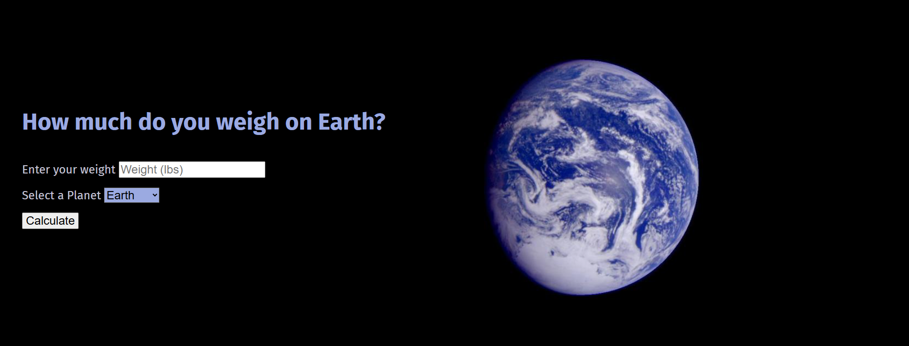
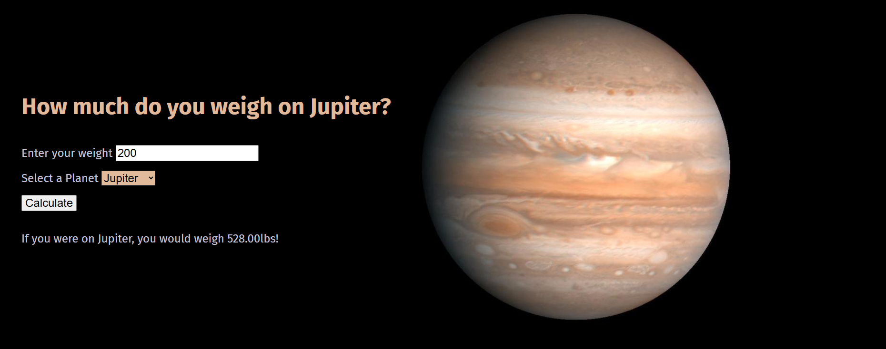

# Astro Weight Calculator

A space-themed web app that shows how much you would weigh on other planets and celestial bodies. Enter your Earth weight in pounds, choose a destination, and calculate your weight based on its gravity relative to Earth.

Built with HTML, CSS, and vanilla JavaScript, this project demonstrates DOM manipulation, event handling, data-driven UI updates, and automated browser testing.

## Features

- Calculate your weight across 11 destinations, including the planets, Pluto, the Moon, and the Sun.
- See results rounded to two decimal places.
- Explore a different image, heading, and accent color for each destination.
- Start with a randomly selected destination each time the page loads.

## Screenshots





Note: Images were taken from NASA's open source library which allows use of the images for educational or informational purposes which extends to personal web pages. 

[NASA Image and Video Library](https://images.nasa.gov/)
[NASA Images and Media Usage Guidelines](https://www.nasa.gov/nasa-brand-center/images-and-media/)

## Run locally

Open `index.html` in your browser, or use the included development server with Node.js and npm installed:

```bash
npm install
npm start
```

Visit [localhost:8888](http://localhost:8888).

## Tests

After installing dependencies, run the Playwright browser tests:

```bash
npm test
```

The tests check that the page loads, the calculator controls are present, and weight calculations produce the expected results for all 11 destinations. The test suite starts its own server on port 8888, so stop the development server before running it.

This project was one part of the Creating Coding Careers Apprenticeship. Passing all tests is a requirement for the course. The UI, images, and randomized planet when entering the webpage were all personal touches added by me.